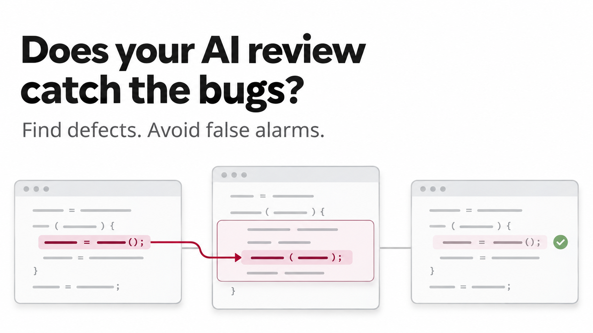

# Does the review find the bugs? An effectiveness test for `ase-repo-review`

[ASE](https://ase.tools) ships a skill called `ase-repo-review`. You point it at a
commit, and an AI model reads the change and writes a code review: a verdict plus
a table of findings, each with a severity and a file location. Such a review can
look convincing even when it misses defects. This benchmark asks a plainer
question: if we know exactly what is wrong with a change, how much of it does the
review catch, and how often does it complain about code that is fine?

## Purpose and scope

What is tested here is not a model on its own but a whole review setup: the
model, the ASE skill and its sub-agent, the Claude Code CLI that runs them, the
tools they may use, the fixed prompt, and the limits of a run. The benchmark
therefore answers one question:

> How does this ASE review setup behave with different models under the same
> test conditions?

It does not answer what the ASE skill itself contributes to review quality.
That would need a second condition: the same model with an ordinary review
prompt, comparable context, tools, and budget. Such a baseline is not part of
this benchmark.

## Current status: pilot

One TypeScript test case with seven seeded defects and four decoys, run three
times per model. Automated scores rely on file and line matching and can disagree
with manual inspection. The reference measurement identified limitations in both
the test case and the scorer that need addressing before broader conclusions
about model performance.

## How the test works

The approach is old and simple. We wrote a small project, introduced a change to
it, and deliberately seeded defects into that change. Since we put the defects
there, we know where they are, so we can check whether the review reports them.

Finding defects is only half of a good review, though. A reviewer that flags
every second line would score perfectly on seeded defects and still be useless.
So the change also contains **decoys**: code that looks suspicious at first
glance but is correct, such as a deliberate fall-through in a `switch` that
carries a comment saying so, or a loose `== null` that deliberately covers both
`null` and `undefined`. A review that reports a decoy may be raising a false
alarm.

The list of defects and decoys, the **expected-results list**, lives in
`solution/expected.json` and never travels with the code under review. The model
sees a plain Git repository with two commits and nothing else; no file name,
commit message, or comment hints at what we expect to be found.

The project under review is "shop-core", a little TypeScript shop with a cart,
discount codes, orders, refunds, notifications, and an API layer. The base commit
(`fixture/base/`) contains no intentionally seeded defects. The change
(`fixture/change/`) looks like a plausible piece of everyday work: it switches
money amounts to integer cents, adds discount kinds, order options with a
currency, and some validation. The seven seeded defects come in three tiers:

- **obvious** defects are visible in a single line, for example a loop that runs
  one position past the end of an array;
- **medium** defects need a little context, for example an `await` that went
  missing inside a `try` block, so a failed save never reaches the `catch`;
- **hidden** defects only show up when you follow the change across files, for
  example a function that now returns cents while its caller in another module
  still formats the value as euros, so the API shows a hundred times the amount.

## Results so far

Every measurement series is kept in the log [MEASUREMENTS.md](MEASUREMENTS.md)
with the values computed at the time, a defect-by-run matrix in plain words, the
findings the scorer could not assign, and the manual reading. Entries are only
ever added, never rewritten, so the original values stay available when the case
or the scorer changes. The summary below is the latest series.

On 2026-11-03 the setup ran three times each with Claude Opus 5.5 and Claude
Sonnet 5.5. The whole measurement cost 3.59 USD, including two earlier plumbing
runs; a run took between one and a half and two minutes.

### Automated scores

The figures below come from the deterministic scorer. It assigns each finding of
a review to an expected entry **only by file name and line overlap** (details in
[Scoring and limitations](#scoring-and-limitations)). A correct finding placed
at a different line, say at the caller instead of the faulty function, does not
count. All values are means over three runs, scored with the current scorer
(entry "Re-scoring … with the fixed location parser" in the log; the original
figures of the first scoring are kept there as well).

| Configuration | Location-matched recall, overall | Location-matched recall, obvious | Decoy match rate | Unassignable findings per run | Pilot thresholds |
|---|---|---|---|---|---|
| Opus 5.5 | 0.95 | 0.83 | 0.17 | 0.3 | met |
| Sonnet 5.5 | 0.90 | 0.67 | 0.50 | 2.0 | not met |

### Manual reading

The raw reviews were also read against the expected-results list (one reader, not
independently verified). The reading changes the picture considerably:

| Configuration | Defects described correctly | Obvious defects described correctly | Decoys claimed to be defects |
|---|---|---|---|
| Opus 5.5 | 21 of 21 (all 7 in every run) | 6 of 6 | 0 of 12 |
| Sonnet 5.5 | 20 of 21 (missed the discount defect once) | 5 of 6 | 2 of 12 |

- Two automated "misses" were defects that the model described correctly but
  placed at the call site or at a neighboring `switch`. A third one was a scorer
  defect: Opus named the right lines as `order.ts:29,51-52`, and the parser read
  only the first range. The parser now reads all ranges; the log keeps both the
  original and the corrected scoring.
- Most automated decoy matches were unrelated findings whose line range happened
  to overlap a decoy, or a misplaced real defect.
- Two Sonnet findings claim that the non-null assertion on the optional customer
  can crash, which the code rules out; one of them sits at the type declaration,
  so the scorer did not even see it. Several other findings of both models
  criticize the optional customer as weak typing without claiming wrong
  behavior, and one Sonnet finding suggests making the documented fall-through
  more explicit. These are design or readability hints and are not counted
  above.
- The unassignable findings were not classified. They include remarks on dead
  code and on the commit message, but they may also contain wrong claims.

By the automated scores, Opus misses defects; by the reading, it found all of
them in every run. The case is therefore too easy for Opus, and the scorer, not
the model, accounts for most of the gap. The log entry lists every case, together
with the models, ASE and CLI versions, digests of the test case, and the version
of the scorer that produced the figures.

## Quick start

You need Node.js 22 or newer and Git; on Windows, PowerShell is enough. These
commands cost nothing and show the whole pipeline with a canned review:

```
node benchmark/repo-review/check.mjs
node benchmark/repo-review/run.mjs --dry-run
node benchmark/repo-review/compare.mjs
```

A real measurement additionally needs the Claude Code CLI (`claude`) with a login
and the built `tool/` of this repository (`cd tool && npm start build`). It costs
money, so it must be confirmed explicitly:

```
node benchmark/repo-review/run.mjs --model sonnet --runs 3 --confirm-paid
node benchmark/repo-review/compare.mjs
```

`compare.mjs` writes `report.md` and `report.json` to `results/report/`. To keep
the series, append it to the log and then add the manual reading by hand below
its generated part:

```
node benchmark/repo-review/compare.mjs --journal benchmark/repo-review/MEASUREMENTS.md --title "2026-11-20: Sonnet 5.5, second case" benchmark/repo-review/results
```

The log refuses a series it already holds, does not accept dry runs, and requires
the scoring code to be committed. Scoring the same runs again with a changed
scorer gives a new entry; the earlier one stays.

## Scoring and limitations

### Deterministic scoring by file and line

A parser reads the findings table of the review (the format is fixed by the
skill). Each finding is assigned to an expected entry if it names the same file
and one of its line ranges overlaps the expected lines, with a tolerance of three
lines; a location may list several ranges, such as `order.ts:29,51-52`.
If several entries qualify, the largest overlap wins, then the smallest distance,
then the smallest id. Findings the skill marks as `ACCEPTED` are ignored. No
language model judges anything; the same reviews always give the same scores.

From that assignment come three figures:

- **Location-matched recall**: the share of the seven defects with a finding at
  a matching location, overall and per tier.
- **Decoy match rate** (in the reports: decoy false-alarm rate): the share of the
  four predefined decoys with a finding at a matching location. It counts any
  such finding, whatever it says, so it can include unrelated remarks.
- **Unassignable findings**: findings that match neither a defect nor a decoy.

On manual reading, a finding on a decoy counts as a false alarm only if it claims
the code behaves wrongly. A hint on readability or maintainability is not a false
alarm.

### What the decoy rate does not cover

The decoy rate measures false alarms on four predefined spots only. Unassignable
findings count neither as hits nor as false alarms. Take a review that finds all
seven defects, leaves the four decoys alone, and adds twenty unfounded
complaints elsewhere: it scores a recall of 1.0 and a decoy rate of 0, although
only seven of its 27 findings are right. That is why the number of unassignable
findings belongs next to the other figures. Counting them all as false alarms
would be wrong as well: they can be real additional defects, fair suggestions,
or unfounded complaints, and only a manual review can tell.

### Pilot thresholds

A configuration meets the predefined pilot thresholds if, on average, overall
recall is at least 0.6, recall on the obvious tier is at least 0.8, and the
decoy match rate is at most 0.25. These are provisional criteria chosen for this
pilot case, not requirements derived from a concrete use. Their strength is that
they were committed in `thresholds.json` *before* the first paid run, so nobody
could tune them to the results; the runner refuses paid runs if that file is
uncommitted or modified.

### Ceiling-effect check

If the strongest model finds every defect in every run, the report says "too
easy". Otherwise it says "adequate", but that only means *no ceiling effect was
detected*. A score below 1.0 does not prove that the case is hard enough or
separates models well: in the reference measurement, the automated score stayed
below 1.0 while the manual reading found every defect.

### Known limitations

- **One small case.** Seven defects in one change cannot rank strong models, and
  this case is too easy for Opus. More runs of the same case show its variance
  but fix neither the matching errors nor the lack of variety.
- **Location matching is blunt.** It misses correct findings placed one hop away
  and credits unrelated findings with wide ranges. Recording alternative
  locations per defect and keeping decoys away from genuine weaknesses of the code
  would help (see the log entry in `MEASUREMENTS.md`).
- **Three runs per model** show tendencies, not significant differences.
- **Cost figures assume Anthropic prices.** For other endpoints the number means
  little.

The suggested order for developing the benchmark further: improve the matching
and the manual check, then add independent test cases, then compare more models.

## Technical reference

### What happens in a run

A run builds a throw-away copy of the example project in the system's temporary
directory: a fresh Git repository with the base commit and the change commit,
both with neutral messages and fixed dates. A **leak check** then scans every
file of the copy for words that could give the answers away (such as "bug",
"decoy", "TODO", or an entry id like `B-01`); a hit stops the run.

The runner then calls the Claude Code CLI non-interactively (`claude -p`, the
"print" mode that takes one prompt, works on it, and exits) with exactly the
prompt `/ase:ase-repo-review -c HEAD -S LOW`, that is, review the last commit and
report everything down to severity LOW. The CLI is fenced in:

- only the ASE plugin of this working copy is loaded, and only the `ase` MCP
  server is reachable, so personal plugins and account connectors stay out;
- the model may read and search files and run `git`, but it may not edit or write
  anything and may not go to the web;
- inherited `CLAUDE*` and `ANTHROPIC_*` environment variables are removed;
- each run has a cost limit (5 USD) and a time limit (20 minutes); a series of
  runs has an overall budget (30 USD) with a 10 % reserve, and a run that reports
  no cost counts with its full limit.

If the CLI loads anything beyond what was allowed, the run ends with an
**isolation** error. If a tool call of the model reaches into this benchmark
(where the expected-results list lives) or into the ASE repository outside the
`plugin/` and `tool/` folders the run legitimately uses, the run ends with a
**contamination** error. Afterwards the runner kills processes the skill left
behind, removes the copy, and writes a result folder with the protocol
(`run.json`), the raw transcript, and the extracted review (`review.md`).

Run status: `ok`, `unparseable` (output not recognizable as a review, counts with
0 hits), `aborted` (cost or time), `error` (leak, isolation, contamination, start,
CLI error result).

### Options

`--budget`, `--timeout-min`, and `--total-budget` change the limits;
`--prior-spent` carries over costs already spent in a series; `--keep` keeps the
throw-away copy for inspection; `--out` sets the location of the result folders.
`node benchmark/repo-review/run.mjs --help` lists all options. Built-in CLI
plugins (`@builtin`) are only logged, not treated as an isolation breach.

`compare.mjs` reports per model recall per tier and overall (mean, minimum,
maximum), the decoy rate, the unassignable findings, the skill verdict per run,
duration and cost, the threshold verdict, and the ceiling-effect statement.
Applied twice to the same folders, `report.json` is byte-identical.

### Other endpoints (open-weight models)

```
$env:BENCH_TOKEN = "<provider token>"
node benchmark/repo-review/run.mjs --model <model-id> --base-url https://provider.example/v1 --auth-token-env BENCH_TOKEN --confirm-paid
```

`--base-url` sets `ANTHROPIC_BASE_URL`, `--auth-token-env` reads the token from the
named variable and sets `ANTHROPIC_AUTH_TOKEN`. The run protocol records the
endpoint (scheme, host, and path only), never the token. To try it without cost:
`node benchmark/repo-review/run.mjs --dry-run --base-url https://example.invalid --auth-token-env BENCH_TOKEN`.

### Testing the harness

These commands check the benchmark itself, not a model, and cost nothing:

```
node benchmark/repo-review/selftest.mjs
node benchmark/repo-review/check-language.mjs
node benchmark/repo-review/run.mjs --dry-run --simulate unparseable
node benchmark/repo-review/run.mjs --dry-run --simulate abort-cost
node benchmark/repo-review/run.mjs --dry-run --simulate abort-time
node benchmark/repo-review/run.mjs --dry-run --simulate leak
```

`--replay <file>` plays back a custom `stream-json` transcript, for example
`testdata/isolation.jsonl` or `testdata/contamination.jsonl`. Dry runs appear in
the report as a separate model group "(dry run)".

### Layout

| Path | Content |
|---|---|
| `fixture/base/`, `fixture/change/` | example project "shop-core": base without seeded defects and the reviewed change |
| `solution/expected.json` | expected-results list: defects in three tiers and decoys with locations (never part of a working copy) |
| `DESIGN.md` | guarantees, non-goals, design decisions, and known risks |
| `thresholds.json` | pre-registered pilot thresholds (committed before the first measurement) |
| `check.mjs` | checks the expected-results list against the fixture |
| `run.mjs` | runner: throw-away copy, leak check, `claude -p`, result folder |
| `compare.mjs` | compares result folders with the expected-results list, report in Markdown and JSON, optionally appended to the log |
| `MEASUREMENTS.md` | log of all measurement series, never rewritten |
| `selftest.mjs` | self-test of parser, matching, metrics, and runner helpers |
| `check-language.mjs` | language check of the deliverable (English only) |
| `testdata/` | canned `stream-json` transcripts for dry runs |
| `reference/` | result folders and machine-readable report of the reference measurement |
| `assets/` | images of this README |
| `results/` | local result folders (not versioned) |

### Going deeper

What the test promises, what it deliberately leaves out, and every design
decision with its reason and its price are written down in
[DESIGN.md](DESIGN.md). Read it before you change the fixture, the matching
rule, or the isolation of the runner.

## Origin

Approach and matching rule follow the effectiveness test of MERIT
(`tests/effectiveness/`); the code is written from scratch.
