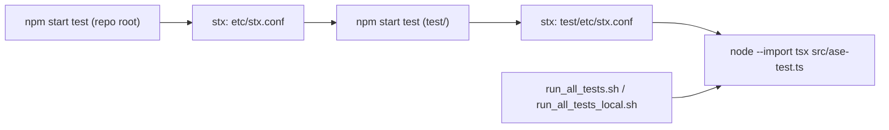
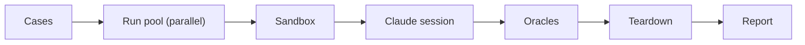
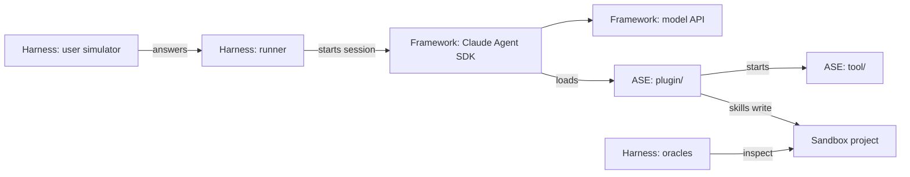
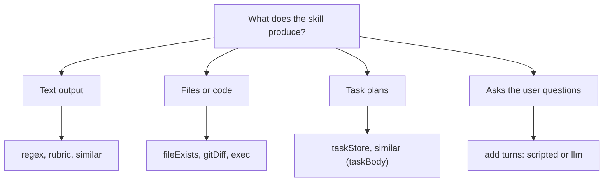

ASE Skill Test Harness: Architecture at a Glance
================================================

A visual quick overview of the skill test harness: how the tests are
executed, how the harness is built, and how to add a new test. For the
details, see `TECH_OVERVIEW.md` (execution and touchpoints) and
`TESTS.md` (usage and the full case contract).

## 1. How the Tests Are Executed

### Launch Chain



All roads end in one program, `src/ase-test.ts`. *stx* is the task
runner of the repository: `npm start <target>` runs the named target of
the local `etc/stx.conf`, and both `test` targets merely forward. The
two scripts call the final command directly, as *stx* treats bare case
names and detached option values as target names (with `npm start`,
write `--cases=<glob>` and `--jobs=8`; see `TESTS.md`). `--import tsx`
runs the TypeScript source directly, so the harness needs no build step.

### One Test Run



-   **Cases**: every `cases/**/case.yaml` is loaded and validated
    up front, so broken cases fail before any money is spent.
-   **Run pool**: every case runs `runs` times, several runs in
    parallel, each in its own throwaway **sandbox** (private HOME,
    project directory, task store, and Git repository).
-   **Claude session**: a real, headless Claude Code session invokes the
    skill; for interactive skills, a simulator plays the user.
-   **Oracles** check the outcome (output, files, task plans, program
    behavior, LLM judgment); then the sandbox is torn down.
-   **Report**: a case passes when at least `minPass` of its runs pass
    (pass@k). All transcripts and a `summary.json` land in
    `results/<timestamp>/`, and the exit code is `0` (all passed), `1`
    (a case failed), or `2` (infrastructure error or cost ceiling hit).

## 2. Overall Architecture



-   **Harness** (`test/src/`): the *runner* loads the cases, schedules
    the runs, and drives the sessions; the *user simulator* answers for
    interactive skills; the *oracles* evaluate the outcome (the LLM
    judges among them also call the model API).
-   **Framework**: the *Claude Agent SDK* ships its own Claude Code
    runtime and does the actual agent work; the models answer through
    the Anthropic API or an Anthropic-compatible gateway (e.g. a local
    model behind LiteLLM). The LLM judges and the LLM simulator use the
    same API.
-   **ASE under test**: the session loads `plugin/` straight from the
    working copy, and the plugin starts the *built* `tool/` (the `ase`
    MCP server and service). Skills write into the sandbox project,
    where the oracles inspect the results.
-   The harness never imports ASE code: it is coupled only through the
    plugin directory, the `ase` CLI, the task file format, and the
    wording of the skill output. The last two are invisible to the
    build, so ASE changes there can break tests silently (see
    `TECH_OVERVIEW.md`).

> **Notice:** after changing `tool/src/`, rebuild the tool
> (`cd tool && npm start build`), else the tests run stale code.

## 3. How and Where to Add a Test

Every test case is one directory below `test/cases/`:

```
test/cases/<group>/<name>/
├── case.yaml          # required: skill, arguments, fixture, oracles
├── fixture/           # optional: seeded task plans and file tree
├── answers.yaml       # optional: scripted user answers
├── persona.md         # optional: persona of the LLM-simulated user
├── rubric.md          # optional: criteria for the "rubric" judge
├── expected-*.md      # optional: golden output for the "similar" judge
└── oracle.py          # optional: reference program for the "exec" oracle
```

Pick the oracles by what the skill produces:



Prefer the mechanical oracles (`regex`, `fileExists`, `gitDiff`,
`taskStore`, `exec`): they are free and deterministic. Use the LLM
judges (`rubric`, `similar`) only where the quality of free text
matters.

Steps:

1.  Create the directory, e.g. `test/cases/meta/mint-uuid/`.
2.  Write the `case.yaml`, e.g.:

    ```yaml
    skill: ase-meta-mint
    args: "uuid test harness fixture"
    budget: { maxUsd: 1.00 }
    oracles:
      - notErrored: true
      - regex:
          in: output
          match: "[0-9a-f]{8}-[0-9a-f]{4}-[0-9a-f]{4}-[0-9a-f]{4}-[0-9a-f]{12}"
    ```

3.  Check the case for free (no session is started):
    `npm start test -- --describe --cases=meta/mint-uuid`.
4.  Run it, keeping the sandbox of a failed run for inspection:
    `npm start test -- -K --cases=meta/mint-uuid`.
5.  For non-deterministic skills, raise `runs` and set `minPass`
    (e.g. `runs: 3`, `minPass: 2`).

The defaults of all keys and the exact oracle semantics are listed in
the "Contract" section of `TESTS.md`; the existing cases are the best
templates.
