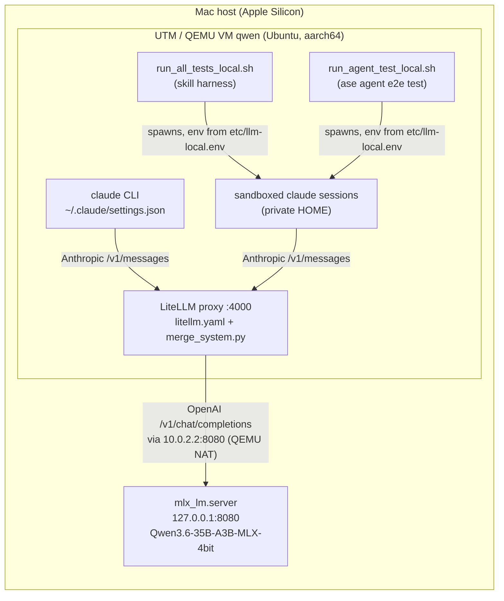
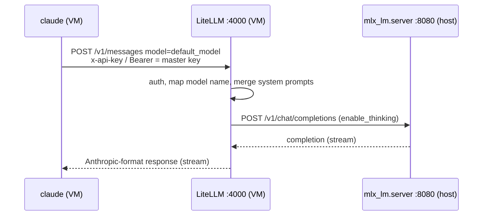

# Local Model Setup

The ASE tests and Claude Code in the VM `qwen` run against a **locally served model**
instead of the Anthropic API. Claude Code speaks the Anthropic Messages API to a
**LiteLLM proxy** inside the VM. LiteLLM translates each request to the OpenAI Chat
Completions API and forwards it to **`mlx_lm.server`** on the Mac host, which serves
Qwen3.6-35B-A3B (MLX, 4-bit).

## Communication



One request, end to end:



`10.0.2.2` is the QEMU user-mode NAT alias of the host. QEMU maps it to the host's
loopback interface, so a server bound to `127.0.0.1` on the Mac is reachable from the VM.

## Configuration files

Secrets are replaced by placeholders: `sk-REPLACE-ME` stands for the LiteLLM master key.

### 1. Model server on the Mac host

```sh
uv tool install mlx-lm
mlx_lm.server \
    --model ~/.lmstudio/models/lmstudio-community/Qwen3.6-35B-A3B-MLX-4bit \
    --host 127.0.0.1 --port 8080 \
    --max-tokens 32768 --temp 0.6 --top-p 0.95 --top-k 20
```

### 2. LiteLLM proxy in the VM: `~/cc/litellm.yaml`

```yaml
model_list:
  - model_name: default_model             # repeat this entry for claude-haiku-5-5,
    litellm_params:                       # claude-sonnet-5-5 and claude-opus-5-5, so any
      model: openai/default_model         # model name Claude Code sends lands on the local model
      api_base: http://10.0.2.2:8080/v1
      api_key: local                      # mlx_lm.server ignores it
      use_chat_completions_api: true
      extra_body:
        enable_thinking: true
general_settings:
  master_key: sk-REPLACE-ME               # the key the clients send
router_settings:
  disable_cooldowns: true                 # a single backend: never mark it as down
litellm_settings:
  callbacks: merge_system.proxy_handler_instance
```

Start it from `~/cc` (so it finds `merge_system.py`):

```sh
uv tool install 'litellm[proxy]'
cd ~/cc && litellm --config litellm.yaml --port 4000
```

### 3. LiteLLM callback: `~/cc/merge_system.py`

Claude Code sends several system blocks, but the Qwen chat template accepts only one
system message, at the start. This pre-call hook merges them all into one:

```python
from litellm.integrations.custom_logger import CustomLogger

def _text(x):
    if isinstance(x, str):  return x
    if isinstance(x, list): return "\n\n".join(b.get("text", "") if isinstance(b, dict) else str(b) for b in x)
    return str(x or "")

class MergeSystem(CustomLogger):
    async def async_pre_call_hook(self, user_api_key_dict, cache, data, call_type):
        parts = [_text(data["system"])] if data.get("system") else []
        rest  = []
        for m in data.get("messages") or []:
            (parts.append(_text(m.get("content"))) if m.get("role") == "system" else rest.append(m))
        joined = "\n\n".join(p for p in parts if p)
        if joined:
            if "system" in data:  data["system"], data["messages"] = joined, rest           # Anthropic format
            else:                 data["messages"] = [{"role": "system", "content": joined}] + rest  # OpenAI format
        return data

proxy_handler_instance = MergeSystem()
```

### 4. Interactive Claude Code in the VM: `~/.claude/settings.json`

```json
{
  "env": {
    "ANTHROPIC_BASE_URL": "http://127.0.0.1:4000",
    "ANTHROPIC_AUTH_TOKEN": "sk-REPLACE-ME",
    "ANTHROPIC_MODEL": "default_model",
    "ANTHROPIC_DEFAULT_OPUS_MODEL": "default_model",
    "ANTHROPIC_DEFAULT_SONNET_MODEL": "default_model",
    "ANTHROPIC_DEFAULT_HAIKU_MODEL": "default_model",
    "CLAUDE_CODE_DISABLE_NONESSENTIAL_TRAFFIC": "1",
    "CLAUDE_CODE_AUTO_COMPACT_WINDOW": "65536",
    "CLAUDE_CODE_MAX_OUTPUT_TOKENS": "8192"
  }
}
```

### 5. ASE tests: `test/etc/llm-local.env` (git-ignored; template: `etc/llm-local.env.sample`)

```sh
ANTHROPIC_BASE_URL=http://127.0.0.1:4000
ANTHROPIC_API_KEY=sk-REPLACE-ME
CLAUDE_CODE_AUTO_COMPACT_WINDOW=65000
CLAUDE_CODE_MAX_OUTPUT_TOKENS=8192
CLAUDE_CODE_DISABLE_NONESSENTIAL_TRAFFIC=1
ASE_TEST_JOBS=1
```

The tests run `claude` with a private sandbox HOME, so they do **not** read
`~/.claude/settings.json`. They get the gateway settings only from this profile.

## Running

```sh
# health checks (in the VM)
curl -s http://10.0.2.2:8080/v1/models          # model server reachable?
curl -s http://127.0.0.1:4000/health/liveliness  # LiteLLM up?

# interactive
claude

# ASE skill test harness (all cases)
cd ~/ase/test && ./run_all_tests_local.sh

# ASE "ase agent" end-to-end test
cd ~/ase/test && ./run_agent_test_local.sh --dry-run            # check the setup only
cd ~/ase/test && ./run_agent_test_local.sh --timeout 2h
```

## Gotchas

- **Use a login shell** (`bash -l`, or log in over SSH interactively). `claude` lives in
  `~/.local/bin` and Node 22.23 in `~/.local/node/bin`, which are only on the `PATH` of
  login shells.
- The agent test sandbox **strips every `CLAUDE*` variable**. It forwards only
  `ANTHROPIC_API_KEY`, `ANTHROPIC_BASE_URL`, `ANTHROPIC_AUTH_TOKEN` and `ANTHROPIC_*MODEL`.
  The compact-window and max-output limits therefore do not apply inside its agents.
- The agent test's credential check accepts `ANTHROPIC_API_KEY`, not
  `ANTHROPIC_AUTH_TOKEN`, which is why the profile uses the former.
  `run_agent_test_local.sh` also pins every model alias to `default_model`.
- `ASE_TEST_JOBS=1`: a single local model handles concurrent generation poorly.
- Reported costs are meaningless. Runs are slow, so raise `--timeout`.
- `write EPIPE` crash at start-up: fixed in commit `8c02f687`. Fast-exiting child
  processes such as `git --version` closed stdin before the test wrote to it.
