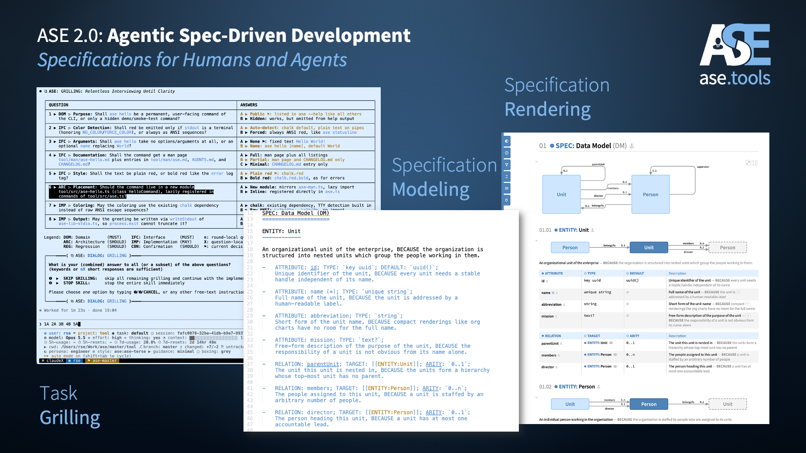
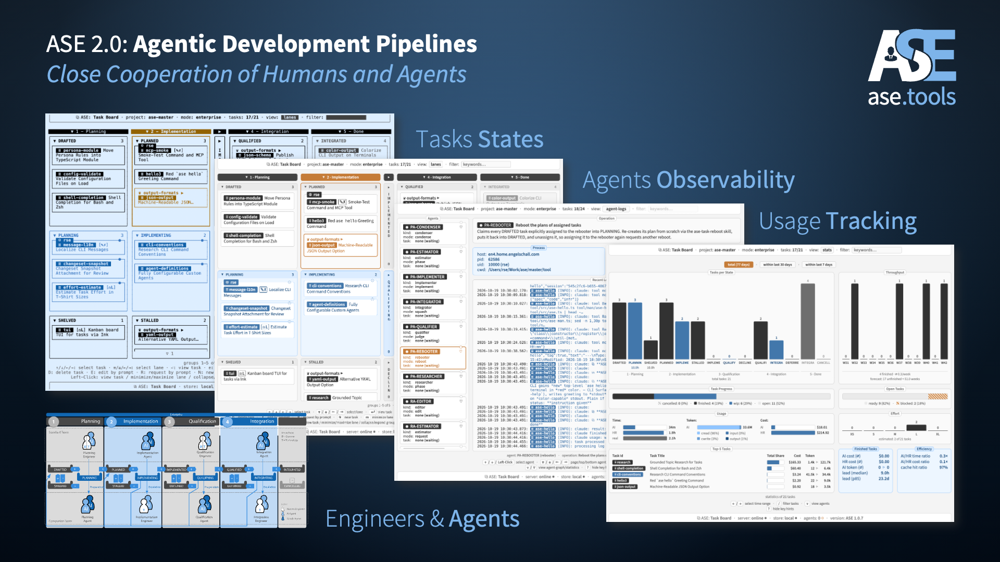
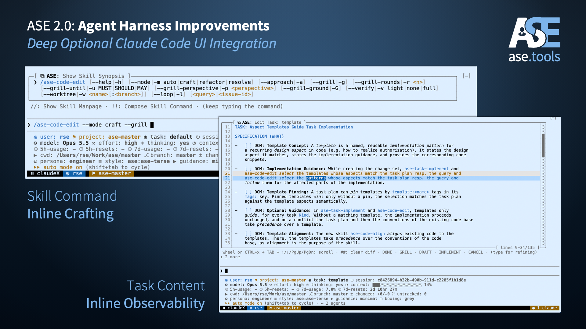

 

 

[ase.tools](https://ase.tools)

**Agentic Software Engineering (ASE)** is the
opinionated [Open Source](https://github.com/rse/ase/blob/master/LICENSE.txt) companion
toolkit of [*Dr. Ralf S. Engelschall*](https://ase.tools/#author)
for fusing the concept of *Agentic AI Coding* and traditional *Software Engineering*
in the software development tool [Anthropic Claude
Code](https://claude.com/product/claude-code) — and with reduced support also in the alternative
tool [GitHub Copilot CLI](https://github.com/features/copilot/cli) or
[OpenAI Codex CLI](https://github.com/openai/codex).

**ASE** ships with 59 agent skills, agent hooks, agent sub-agents, an
underlying Model-Context-Protocol (MCP) service and a Command-Line Interface
(CLI) with a task store, task boards, and autonomous agents, incorporating
reasonable methodology and automation aspects, to support the recurring
tasks of a *Software Developer* and *Software Architect*.

